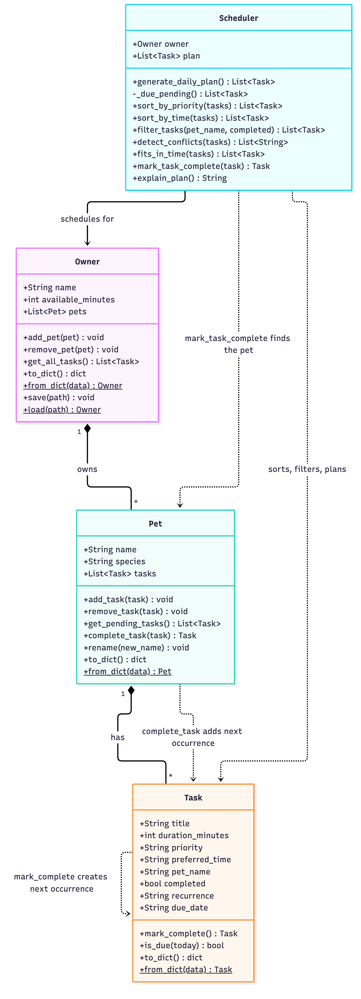

# PawPal+ (Module 2 Project)

PawPal+ is a Streamlit app that helps a busy pet owner plan daily care for their pets. It tracks tasks (walks, feeding, meds, grooming and so on), respects the time the owner has available, and produces a prioritized daily plan with an explanation of why it was chosen.

## ✨ Features

- **Priority-based planning:** pending tasks are sorted high, then medium, then low. Ties go to the earlier preferred time, then the shorter task.
- **Time-budget fitting:** tasks are taken in priority order until the owner's available minutes run out. A task that doesn't fit is skipped so smaller, lower-priority tasks can still use the leftover time.
- **Sorting by time:** any task list can be ordered by preferred `HH:MM`, with tasks that have no preferred time placed last.
- **Filtering:** view tasks for one pet, only pending or only completed tasks, or both filters together.
- **Conflict warnings:** tasks with a preferred time are compared by start and end, and overlapping windows (including across different pets) produce a warning. Back-to-back tasks are not conflicts, and nothing is moved or removed automatically.
- **Daily and weekly recurrence:** completing a recurring task marks it done and creates the next occurrence 1 or 7 days after its due date. Future-dated tasks stay out of today's plan until due, and completing a task twice never creates duplicates.
- **Next available slot:** `find_next_available_slot()` finds the earliest time of day (07:00 to 21:00 by default) where a task of a given length fits without overlapping the timed tasks in the plan.
- **Plan explanation:** `explain_plan()` lists every scheduled task and every task that was skipped for lack of time.
- **Persistence:** the owner, pets and tasks are saved to `pawpal_data.json` and reloaded on startup.

## Getting started

```bash
python -m venv .venv
source .venv/bin/activate  # Windows: .venv\Scripts\activate
pip install -r requirements.txt

streamlit run app.py   # the web app
python main.py         # command-line demo
python -m pytest       # tests
```

## 🛠️ Implementation Summary

The core logic lives in `pawpal_system.py` and is made of four classes:

- **`Task`** (dataclass) is one care activity: title, duration, priority (`high`/`medium`/`low`), an optional preferred time, the name of its pet, a completed flag, and optional `recurrence` (`daily`/`weekly`) and `due_date`.
- **`Pet`** (dataclass) owns a list of tasks. Adding a task stamps it with the pet's name; it can also be renamed, and completing a recurring task adds the next occurrence.
- **`Owner`** (dataclass) has a name, a daily time budget in minutes, and a list of pets. `get_all_tasks()` flattens every pet's tasks into one list, and `save()`/`load()` persist everything as JSON.
- **`Scheduler`** takes an `Owner` and produces the plan, plus sorting, filtering and conflict detection.

How they work together: an `Owner` holds `Pet`s, and each `Pet` holds `Task`s. When `Scheduler.generate_daily_plan()` runs, it collects the owner's pending tasks that are due, sorts them by priority (ties go to the earlier preferred time, then the shorter task), and keeps tasks in that order while they fit in the owner's available minutes. A task that doesn't fit is skipped so smaller ones can still be scheduled. The result is stored in `scheduler.plan`, `detect_conflicts()` checks it for overlapping times, and `explain_plan()` turns it into text that lists each scheduled task and each skipped one.

### Final UML



Source: [`diagrams/uml_final.mmd`](diagrams/uml_final.mmd)

`main.py` is a command-line demo of this flow, and `tests/test_pawpal.py` holds the tests (run with `python -m pytest`).

## 🧪 Testing PawPal+

Run the full suite from the repo root:

```bash
python -m pytest
```

**What the tests cover** (`tests/test_pawpal.py`, 26 tests):

- **Sorting:** tasks come back in chronological order (untimed last), sorting doesn't mutate its input, and priority sort breaks ties by time.
- **Recurrence:** completing a daily/weekly task creates the next occurrence (correct date, across month boundaries, details preserved); non-recurring tasks create nothing; completing twice doesn't duplicate.
- **Conflict detection:** duplicate and overlapping times are flagged (same pet and across pets); back-to-back tasks, untimed tasks and malformed times are not.
- **Planning:** the plan respects the time budget, skips completed and future-dated tasks, and handles an owner with no pets.
- **Basics:** task completion, adding/renaming pets' tasks, filtering, and JSON save/load round-trip.

Test output:

```
============================= test session starts ==============================
platform darwin -- Python 3.15.0, pytest-9.1.1, pluggy-1.7.0 -- /Users/haomingli/.local/share/mise/installs/python/latest/bin/python
cachedir: .pytest_cache
rootdir: /Users/haomingli/repos/ai110-module2show-pawpal-starter
plugins: platformdirs-4.13.0, anyio-4.15.1
collecting ... collected 26 items

tests/test_pawpal.py::test_mark_complete_changes_status PASSED           [  3%]
tests/test_pawpal.py::test_add_task_increases_pet_task_count PASSED      [  7%]
tests/test_pawpal.py::test_owner_save_and_load_round_trip PASSED         [ 11%]
tests/test_pawpal.py::test_rename_pet_updates_task_pet_names PASSED      [ 15%]
tests/test_pawpal.py::test_sort_by_time_puts_unset_last PASSED           [ 19%]
tests/test_pawpal.py::test_filter_by_pet_and_status PASSED               [ 23%]
tests/test_pawpal.py::test_daily_task_recurs_next_day PASSED             [ 26%]
tests/test_pawpal.py::test_weekly_task_recurs_in_seven_days PASSED       [ 30%]
tests/test_pawpal.py::test_non_recurring_task_returns_none PASSED        [ 34%]
tests/test_pawpal.py::test_future_recurrence_is_left_out_of_plan PASSED  [ 38%]
tests/test_pawpal.py::test_detect_conflicts_flags_overlap_only PASSED    [ 42%]
tests/test_pawpal.py::test_scheduler_mark_task_complete_adds_next_occurrence PASSED [ 46%]
tests/test_pawpal.py::test_completing_twice_does_not_duplicate PASSED    [ 50%]
tests/test_pawpal.py::test_detect_conflicts_ignores_malformed_time PASSED [ 53%]
tests/test_pawpal.py::test_sort_by_time_is_chronological_for_unsorted_input PASSED [ 57%]
tests/test_pawpal.py::test_sort_by_time_does_not_mutate_input PASSED     [ 61%]
tests/test_pawpal.py::test_sort_by_priority_orders_high_to_low_then_time PASSED [ 65%]
tests/test_pawpal.py::test_daily_recurrence_crosses_month_boundary PASSED [ 69%]
tests/test_pawpal.py::test_daily_recurrence_without_due_date_uses_today PASSED [ 73%]
tests/test_pawpal.py::test_recurring_copy_keeps_details_and_is_pending PASSED [ 76%]
tests/test_pawpal.py::test_detect_conflicts_flags_duplicate_times PASSED [ 80%]
tests/test_pawpal.py::test_detect_conflicts_flags_duplicate_times_across_pets PASSED [ 84%]
tests/test_pawpal.py::test_detect_conflicts_back_to_back_is_not_a_conflict PASSED [ 88%]
tests/test_pawpal.py::test_detect_conflicts_ignores_untimed_tasks_and_empty_input PASSED [ 92%]
tests/test_pawpal.py::test_plan_respects_time_budget_and_skips_completed PASSED [ 96%]
tests/test_pawpal.py::test_plan_for_owner_with_no_pets_is_empty PASSED   [100%]

============================== 26 passed in 0.03s ==============================
```

**Confidence Level: ⭐⭐⭐⭐ (4/5)** — all 26 tests pass and cover the core scheduling behaviors and edge cases. Not 5 because the Streamlit UI (`app.py`) is untested and conflict detection only compares tasks by their preferred times.

## 📐 Smarter Scheduling

| Feature | Method(s) | Notes |
|---------|-----------|-------|
| Sorting by priority | `Scheduler.sort_by_priority()` | High before medium before low; ties go to the earlier preferred time, then the shorter task |
| Sorting by time | `Scheduler.sort_by_time()` | Orders by preferred `HH:MM`; tasks with no time go last |
| Filtering | `Scheduler.filter_tasks(pet_name, completed)` | Limit to one pet, a status, or both; `None` means no filter |
| Time budget | `Scheduler.fits_in_time()` | Keeps tasks in order until the owner's minutes run out; skips one that doesn't fit so smaller ones can still use the time |
| Conflict detection | `Scheduler.detect_conflicts()` | Warns about overlapping preferred-time windows |
| Next available slot | `Scheduler.find_next_available_slot(duration_minutes, earliest, latest)` | Sweeps the timed tasks in order and returns the first `HH:MM` gap that is long enough, or `None` |
| Recurring tasks | `Task.mark_complete()`, `Pet.complete_task()`, `Scheduler.mark_task_complete()` | Completing a daily or weekly task creates the next occurrence |

### Sorting
`generate_daily_plan()` sorts pending tasks with `sort_by_priority()`. Use
`sort_by_time()` for a clock-order view, such as the task list in the app.

### Filtering
`filter_tasks(pet_name="Kiki", completed=False)` returns Kiki's pending tasks.
The app's "Show pet" and "Show status" controls use it. The planner also leaves
out completed tasks and tasks whose `due_date` is in the future.

### Conflict detection
`detect_conflicts()` checks the current plan, or a list you pass in. It sorts
tasks with a preferred time by start, then compares each task only with later
ones until one starts after it ends (O(n log n) plus the overlaps found). A
task that starts exactly when another ends is not a conflict. It returns
warning strings, which the app shows as warnings. It never removes or moves a
task. Tasks with no preferred time, or a malformed one, are ignored.

### Recurring tasks
A task has `recurrence` (`"daily"`, `"weekly"`, or empty) and an ISO
`due_date`. `Task.mark_complete()` marks the task done and, if it recurs,
returns a copy due 1 or 7 days after the old due date (or after today if it had
none). `Scheduler.mark_task_complete()` finds the owning pet and adds that copy
through `Pet.complete_task()`, so completing a recurring task automatically
creates the next one. Completing an already-completed task does nothing, so it
can't create duplicates. Call `Task.mark_complete()` directly and you get the
new task back but it is not added to a pet.

## 📸 Demo Walkthrough

### Main UI features
The Streamlit app (`streamlit run app.py`) lets you:

- **Owner:** set your name and the minutes you have available today.
- **Pets:** add a pet (name and species), rename it, or remove it. Duplicate names are rejected.
- **Tasks:** add a task with a title, duration, priority, optional preferred time (`HH:MM`) and repeat setting (none, daily or weekly). The task list can be filtered by pet and status and sorted by entered order or preferred time. Each row has **Done** and **Remove** buttons.
- **Today's Schedule:** click **Generate schedule** to see the plan, summary metrics, warnings and an explanation of the choices.

### Example workflow
1. Set the owner name to Jordan and available time to 90 minutes.
2. Add a pet, for example Mochi (dog), then another, Kiki (cat).
3. Add tasks such as "Morning walk" (30 min, high, 07:30, daily) for Mochi and "Breakfast" (10 min, high, 07:45) for Kiki.
4. Use "Sort by: Preferred time" and the pet and status filters to review the list. A warning appears right away if two pending tasks overlap.
5. Click **Done** on a daily task. It is marked complete and the next occurrence is added, due tomorrow.
6. Click **Generate schedule** to view today's plan, with minutes used, any conflict warnings and any skipped tasks.

### Scheduler behaviors shown
- **Sorting:** the plan is ordered by priority, and the time-sorted view shows the same tasks in clock order.
- **Conflict warnings:** overlapping preferred times are flagged with the tasks and pets involved, as `st.warning` messages in the UI.
- **Time budget:** tasks that don't fit are listed as skipped instead of being silently dropped.
- **Recurrence:** completing a daily or weekly task creates its next occurrence.

### Sample CLI output
Output of `python main.py`:

```text
Entered order:
  18:00 Brush coat (Mochi)
  07:30 Morning walk (Mochi)
  --    Evening stroll (Mochi)
  17:00 Grooming appointment (Mochi)
  17:00 Play with feather toy (Kiki)
  12:00 Give medication (Kiki)
  07:45 Breakfast (Kiki)
Sorted by time:
  07:30 Morning walk (Mochi)
  07:45 Breakfast (Kiki)
  12:00 Give medication (Kiki)
  17:00 Grooming appointment (Mochi)
  17:00 Play with feather toy (Kiki)
  18:00 Brush coat (Mochi)
  --    Evening stroll (Mochi)

Completed 'Give medication'; next due 2026-10-21
Kiki pending: ['Play with feather toy', 'Breakfast', 'Give medication']
Completed: ['Give medication']

WARNING: Conflict (Mochi and Kiki): 'Morning walk' at 07:30 (30 min) overlaps 'Breakfast' at 07:45.
WARNING: Conflict (Mochi and Kiki): 'Grooming appointment' at 17:00 (10 min) overlaps 'Play with feather toy' at 17:00.
================================================================
                   TODAY'S SCHEDULE - Jordan                    
================================================================
Pets: Mochi (dog), Kiki (cat)
Time available: 90 min
----------------------------------------------------------------
#  Preferred  Task                    Pet      Min  Priority
----------------------------------------------------------------
1  07:30      Morning walk            Mochi     30  high
2  07:45      Breakfast               Kiki      10  high
3  17:00      Grooming appointment    Mochi     10  high
4  17:00      Play with feather toy   Kiki      20  medium
5  --         Evening stroll          Mochi     15  medium
----------------------------------------------------------------
Total: 85 of 90 min scheduled

Why this plan:
Jordan has 90 minutes today; the plan uses 85.
1. Morning walk (Mochi) - 30 min, high priority, preferred 07:30
2. Breakfast (Kiki) - 10 min, high priority, preferred 07:45
3. Grooming appointment (Mochi) - 10 min, high priority, preferred 17:00
4. Play with feather toy (Kiki) - 20 min, medium priority, preferred 17:00
5. Evening stroll (Mochi) - 15 min, medium priority
Skipped: Brush coat (Mochi) - 40 min did not fit in the remaining time.
```
